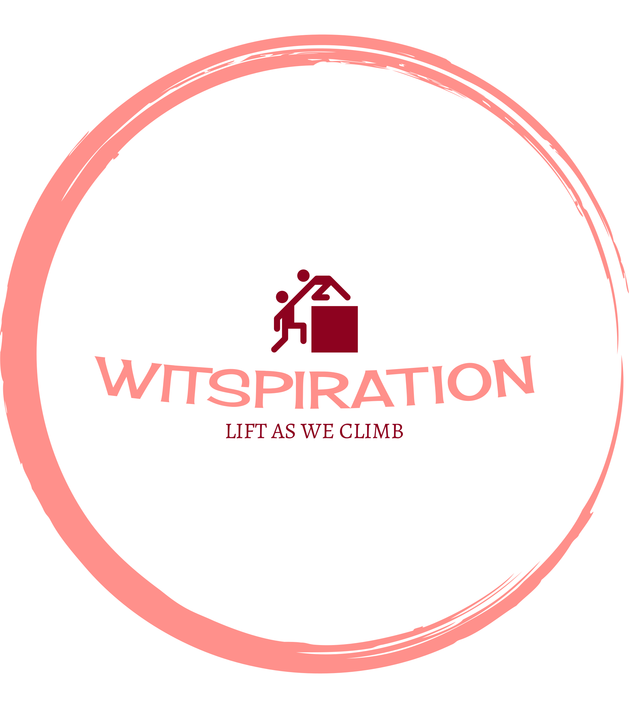

## Mission Statement

To inspire and empower women in tech, starting with the data platform community, to thrive in their careers through community based mentorship.

## Commitment to DEI

We are committed to making sure WITspiration is open and welcoming to all and are committed to be a space that respects and encourages diversity, equality and inclusion.

## Sign Ups

You may sign up for WITspiraiton [here](You can sign up for WITspiraiton [here](https://docs.google.com/forms/d/e/1FAIpQLSd3aQbrE70zFFUdKB9LVIhz4ReemJ4RWd2lZ-zT8q3YUs63LA/viewform?usp=sharing&ouid=102619307538916466096), and we will contact you soon.), and we will contact you shortly.

## Social Media

- [LinkedIn](https://www.linkedin.com/groups/12786585/)
- [Mastadon](https://dataplatform.social/@DPWITspiration)
- [Twitter](https://twitter.com/DPWITspiration)
